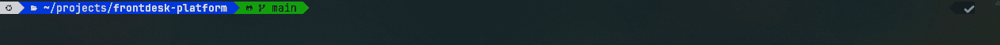
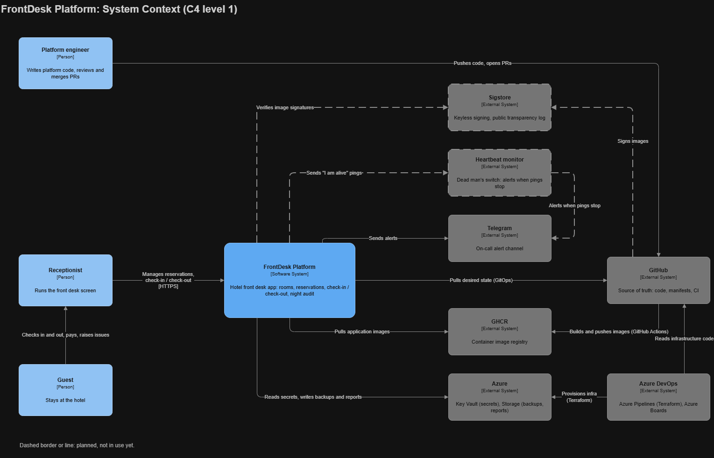
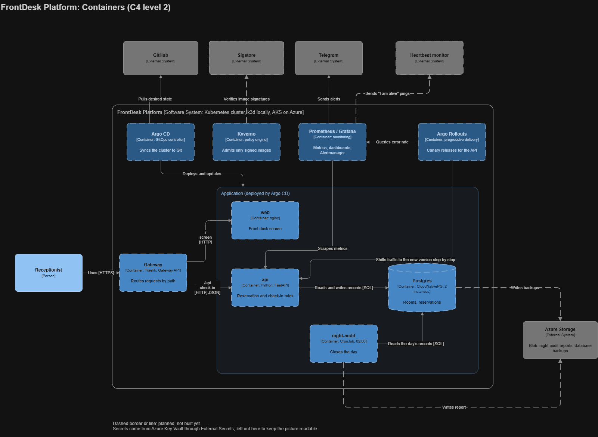

# FrontDesk Platform

A hotel front-desk application running on a platform I am building myself: signed container images,
policy-as-code, GitOps delivery, SLO-based canary releases, and Azure infrastructure provisioned with
Terraform and Azure Pipelines.

> **Status:** work in progress. The application runs on a local Kubernetes cluster and is delivered by
> GitOps from this repository. Network policy, observability, canary releases and AKS come next (see
> [Roadmap](#roadmap)). Only what is listed under [What works today](#what-works-today) has been built
> and run.

## Why this project

Before moving into cloud and DevOps, I worked at a hotel front desk. At the desk, two things matter most:
the system has to be up while a guest is standing in front of you, and a bad change must never lose a
reservation.

This project turns that experience into a platform question: how do you ship changes to a front-desk
application often, without putting check-in at risk?

## What works today

| Area | What is in place |
| --- | --- |
| Application | Reception screen, reservation API, nightly audit CronJob (02:00 Europe/Istanbul), PostgreSQL with two instances managed by CloudNativePG |
| Pull requests | Lint, tests against PostgreSQL, and a smoke test of the platform contract on the built images; `main` accepts changes only through a PR with these checks green |
| Images | Multi-stage, non-root images; Trivy blocks fixable CRITICAL and HIGH findings; keyless cosign signatures on the digest; pushed to GHCR |
| Supply chain | Third-party actions pinned to commit SHAs; Dependabot for pip, Docker and GitHub Actions |
| Admission | Kyverno admits our images only when the release workflow on `main` signed them; in the `frontdesk` namespace it also rejects images tagged `latest` and containers without CPU and memory limits, and the namespace enforces the restricted Pod Security Standard |
| Delivery | Argo CD follows `platform/argocd/` (app of apps, including Argo CD itself); sync waves start the database, then migrations, then the api and the screen; a bot PR promotes each new image digest |
| Traffic | Traefik implements Gateway API; one HTTPRoute serves `frontdesk.localhost` |
| Azure | Terraform state in Azure Storage with Entra ID access and a subscription budget alert; Azure Pipelines applies the network module through Workload Identity Federation, with an approval before apply |

## How a change reaches the cluster

1. A pull request runs the checks; it is merged only when they pass.
2. `release.yml` builds both images, scans them, pushes them and signs their digests.
3. Its `promote` job opens a pull request, as a GitHub App, that writes the new digests into
   `deploy/overlays/local`. The same checks run on it.
4. Merging that pull request is the only manual step. It does not trigger another release.
5. Argo CD sees the new digests in Git and rolls out new pods. Kyverno verifies each image's signature
   before the pod is admitted.

An image built and pushed from a laptop never gets that signature, so the cluster rejects it:



The reasons for each step are in [ADR-0007](docs/adr/0007-promotion-by-digest.md).

## Architecture





The diagrams show the target architecture; parts drawn with dashed lines are not built yet. Source:
[docs/architecture.drawio](docs/architecture.drawio).

## Run it locally

Requires Docker, k3d, kubectl and Helm (versions in [docs/versions.md](docs/versions.md)).

```bash
make up
```

When every Argo CD Application reports `Synced` and `Healthy`
(`kubectl get applications -n argocd`), open http://frontdesk.localhost.

| Command | What it does |
| --- | --- |
| `make up` | Creates the k3d cluster, installs CloudNativePG and Argo CD with Helm, and applies the root Application; Argo CD deploys everything else from Git |
| `make down` | Deletes the local cluster |
| `make test` | Runs the application tests; database tests are skipped unless `TEST_DATABASE_URL` is set |
| `make lint` | Checks the code with ruff and renders the Kubernetes manifests |

`make test` and `make lint` use the virtual environment in `app/.venv` (setup in
[app/README.md](app/README.md)).

## Repository layout

| Path | Contents |
| --- | --- |
| `app/` | API, nightly audit job, database migrations, application tests |
| `web/` | Reception screen |
| `deploy/` | Kustomize base and overlays for the application |
| `platform/` | Argo CD Applications for the cluster components, Kyverno policies |
| `infra/` | k3d cluster config, Terraform modules and Azure Pipelines definitions |
| `.github/` | GitHub Actions workflows and Dependabot |
| `scripts/` | Smoke test |
| `docs/` | Contracts, architecture diagrams, decision records |

## Decisions

| ADR | Decision |
| --- | --- |
| [0001](docs/adr/0001-repo-location-and-layout.md) | Repository location and layout |
| [0002](docs/adr/0002-merge-strategy.md) | Squash merge for pull requests |
| [0003](docs/adr/0003-terraform-bootstrap.md) | Terraform bootstrap for state, budget and pipeline identity |
| [0004](docs/adr/0004-two-ci-systems.md) | GitHub Actions for the application, Azure Pipelines for the infrastructure |
| [0005](docs/adr/0005-helm-vs-kustomize.md) | Kustomize for our manifests, Helm for third-party software |
| [0006](docs/adr/0006-gateway-api.md) | Gateway API with Traefik instead of Ingress |
| [0007](docs/adr/0007-promotion-by-digest.md) | Promote images by digest through a bot pull request |

## Roadmap

| Next | Goal |
| --- | --- |
| Network policy | Pods accept traffic only from the components that need them |
| Observability | Prometheus metrics, dashboards, SLO alerts to Telegram |
| Canary releases | Argo Rollouts promotes or rolls back a release based on SLO metrics |
| Azure | The same platform on AKS, provisioned with Terraform and Azure Pipelines |

## Conventions

Commit messages follow [Conventional Commits](https://www.conventionalcommits.org/) (`type(scope): summary`), so the type of each change shows which part of the version number it bumps.

## Known limitations

- **No SBOM attestation.** Images are scanned and signed, but no software bill of materials is generated or attached to them. Cut to fit the project timeline. Next step: generate a CycloneDX SBOM with Trivy in `release.yml` and attach it to the image digest with `cosign attest`.
- **Third-party images are not signature-checked.** Kyverno verifies only `ghcr.io/elxeoo/*`; the images of Argo CD, CloudNativePG and Kyverno itself are trusted through their pinned chart versions. Next step: verify their publishers' cosign signatures where they provide them.
- **Browsers can keep the previous screen after a release.** The web image sets no cache headers, so a browser may reuse old JavaScript until a hard refresh. Next step: cache headers in `web/nginx.conf` that make the browser revalidate.

## License

MIT. See [LICENSE](LICENSE).
