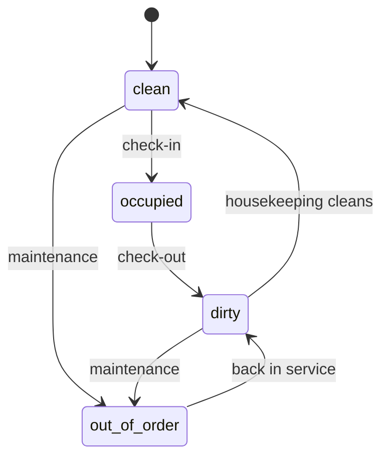
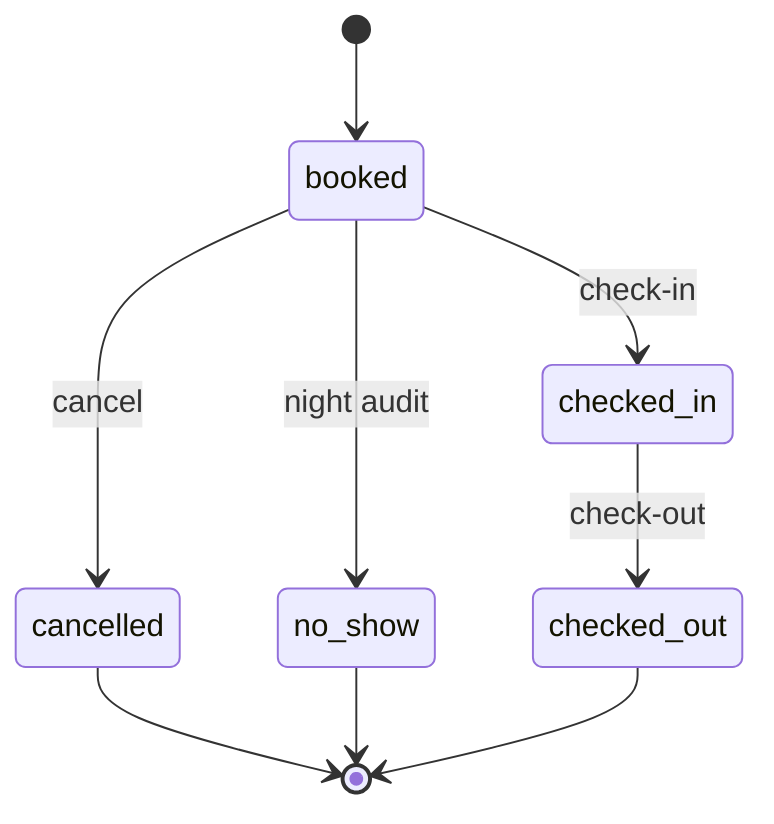

# Domain Model

FrontDesk models a small part of a hotel front office: rooms, reservations, check-in and check-out.
The rules come from day-to-day front desk practice. The application is deliberately small, because its
job is to give the platform something real to deploy, observe and break.

Each rule has a stable ID (`R1` to `R7`). Tests and API error responses refer to rules by this ID.

## Glossary

| Term | Meaning |
| --- | --- |
| Room | A sellable unit with a number, a type and a capacity. |
| Reservation | One room promised to one guest party for a date range. |
| Arrival date | The first night of the stay. |
| Departure date | The day the guest leaves. A stay covers the nights from arrival up to, but not including, departure. |
| Party | The guests on a reservation, counted as adults and children. |
| Check-in | The guest arrives and receives the room. |
| Check-out | The guest leaves and the room is released. |
| No-show | A guest who never arrived on any day of the stay. |
| Business day | The hotel day that the night audit closes. |
| Night audit | The nightly job that closes the business day. |

All dates use the hotel's time zone, `Europe/Istanbul`.

## Entities

**Room**

| Field | Description |
| --- | --- |
| `number` | Unique room number, for example `101`. |
| `type` | Room type, for example `standard` or `family`. |
| `max_adults` | Most adults the room can take. |
| `max_occupancy` | Most guests in total, adults and children together. |
| `status` | Housekeeping status, see below. |

**Reservation**

| Field | Description |
| --- | --- |
| `id` | Unique reservation ID. |
| `room_number` | The reserved room. |
| `guest_name` | Name of the main guest. |
| `arrival_date` | First night of the stay. |
| `departure_date` | Day of departure. |
| `adults` | Number of adults in the party. |
| `children` | Number of children in the party. |
| `status` | Reservation status, see below. |

## Room status

| Status | Meaning |
| --- | --- |
| `clean` | Empty and ready for a guest. |
| `occupied` | A guest is checked in. |
| `dirty` | Empty but not cleaned yet. |
| `out_of_order` | Closed for maintenance. Cannot be given to a guest. |

A room that comes back from maintenance returns as `dirty`, so housekeeping inspects it before it is
sold again.

## Reservation status

`cancelled`, `no_show` and `checked_out` are final. A reservation in a final status never changes again.

## Rules

### Creating a reservation

- **R1. Valid reservation.** The departure date is after the arrival date. The party has at least one
  adult. The party fits the room: `adults <= max_adults` and `adults + children <= max_occupancy`.
- **R2. No double booking.** A room cannot hold two active (`booked` or `checked_in`) reservations whose
  stays overlap. Two stays `[arrival, departure)` overlap when each one starts before the other ends.
  A guest leaving on a day and a new guest arriving on the same day do not overlap: check-out is by 12:00
  and check-in starts at 14:00, which leaves housekeeping time to clean the room.

### Check-in

- **R3. Late arrival window.** A guest who does not arrive on the arrival date keeps the reservation.
  Check-in is allowed on any day from the arrival date up to the day before departure
  (`arrival_date <= today < departure_date`). Check-in before the arrival date is refused.
  Standard check-in starts at 14:00. An earlier check-in on the arrival date is a front desk courtesy,
  given only when a clean room is available (R5). The application leaves that call to the receptionist
  and does not enforce the time of day.
- **R4. The party must match.** At check-in, the number of adults and children must equal the
  reservation, because the price of a stay depends on how many adults and children it has. A larger
  party, or an adult in place of a booked child, is refused. The reservation must be changed first.
- **R5. Ready room only.** Check-in requires the room to be `clean`. A `dirty`, `occupied` or
  `out_of_order` room is refused.

### After check-in

- **R6. Order of operations.** Check-out is allowed only from `checked_in`, and it moves the room to
  `dirty`. Cancel is allowed only from `booked`.
- **R7. No-show is decided at night.** When the night audit closes business day `D`, every `booked`
  reservation with `departure_date <= D + 1` becomes `no_show`, because no check-in day is left. Until
  then the reservation rolls forward, the way a front desk carries an expected arrival to the next day.

## Out of scope

These exist in a real hotel and are left out on purpose:

- Payments, rates and invoices
- Travel agencies and channel managers
- Guest identity capture and the legal guest report to the authorities
- Key cards and door locks
- Infants and extra beds (cots)
- Overbooking
- Room moves and changes to a stay after check-in
